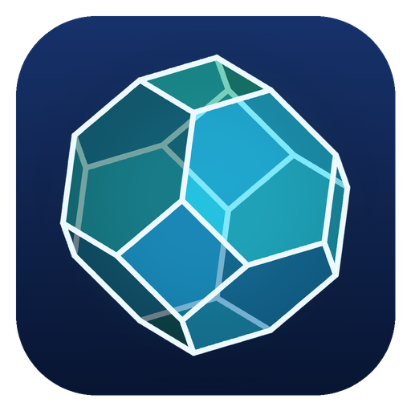
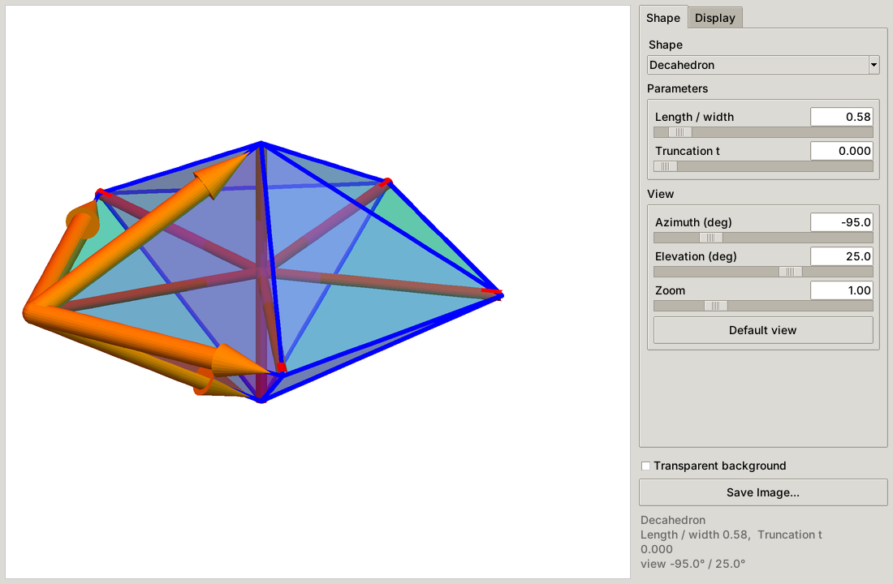
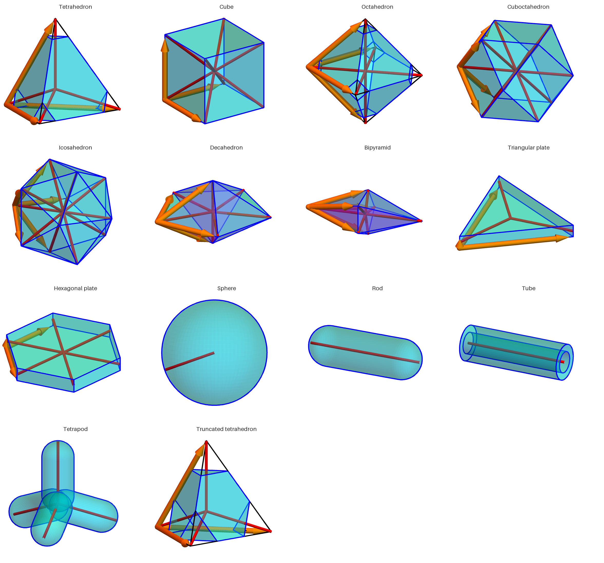
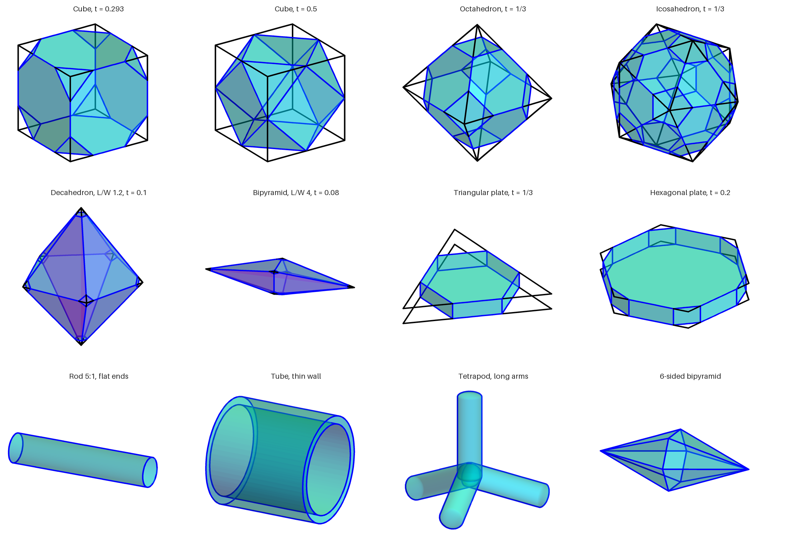
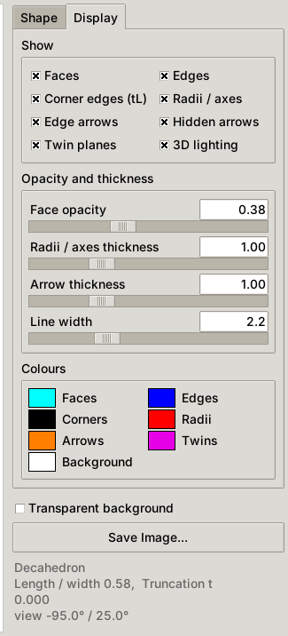
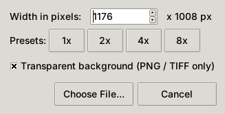
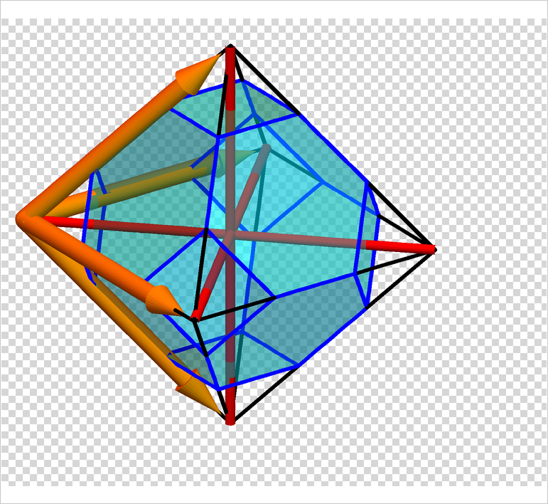

<p align="center">
  
</p>

<h1 align="center">Nanocrystal Shapes</h1>

<p align="center">
  A small desktop app that draws common nanocrystal shapes as clean, translucent 3D figures
  for slides, posters, papers and teaching.<br>
  Windows · macOS · Linux · pure Python
</p>

<p align="center">
  
</p>

---

## Contents

- [Features](#features)
- [Shapes and parameters](#shapes-and-parameters)
- [Installation](#installation)
- [Starting the app](#starting-the-app)
- [Using the app](#using-the-app)
- [Saving images](#saving-images)
- [Troubleshooting](#troubleshooting)
- [Privacy and safety](#privacy-and-safety)
- [Project structure](#project-structure)
- [Credits and acknowledgment](#credits-and-acknowledgment)
- [License](#license)

## Features

- **13 shapes:** tetrahedron, cube, octahedron, cuboctahedron, icosahedron, decahedron,
  bipyramid, triangular plate, hexagonal plate, sphere, rod, tube and tetrapod.
- **Truncation:** every polyhedron can have its corners cut off by a fraction *t* of the edge
  length, which gives the truncated tetrahedron, truncated octahedron, cuboctahedron and so on.
- **Twin planes** for the five-fold twinned decahedron and penta-twinned bipyramid.
- **Annotations:** corner edges (*tL*), radii / axes from the centre and edge-vector arrows.
  You can switch each one on or off and change its thickness and colour.
- **Interactive 3D view:** drag to rotate, scroll to zoom.
- **Export:** PNG, JPEG, TIFF, BMP or PDF at any resolution, optionally with a
  **transparent background**.
- **No install step:** a launcher for each operating system. The only dependency is Pillow,
  and the app offers to install it if it is missing.

<p align="center">
  
</p>

## Shapes and parameters

| Shape | Parameters | Useful values |
|---|---|---|
| Tetrahedron | truncation *t* | *t* = 1/3: truncated tetrahedron |
| Cube | truncation *t* | *t* = 0.293: truncated cube; *t* = 0.5: cuboctahedron |
| Octahedron | truncation *t* | *t* = 1/3: truncated octahedron |
| Cuboctahedron | truncation *t* | |
| Icosahedron | truncation *t* | *t* = 1/3: truncated icosahedron |
| Decahedron | length / width, *t* | 0.577: ideal decahedron (five regular tetrahedra); larger: elongated |
| Bipyramid | number of sides, length / width, *t* | 5 sides: penta-twinned (gold) bipyramid |
| Triangular plate | thickness / edge, corner truncation *t* | *t* = 1/3: hexagonal outline |
| Hexagonal plate | thickness / edge, corner truncation *t* | |
| Sphere | none | |
| Rod | length / diameter, end rounding | rounding 0: flat ends; 1: hemispherical ends |
| Tube | length / diameter, inner / outer diameter | |
| Tetrapod | arm length / diameter, end rounding | |

**Truncation *t*** cuts each corner where the cut meets every edge at a distance *tL* from the
corner, so each original edge keeps a middle piece of length (1 − 2*t*)*L*.

<p align="center">
  
</p>

## Installation

### 1. Get the files

**Download the ZIP** of the latest [release](../../releases), or click the green **Code** button
on this page and choose **Download ZIP**. Git users can copy the address under **Code** and clone it:

```bash
git clone <address from the Code button>
```

Keep the folder somewhere permanent, for example `Documents/Apps/NanocrystalShapes`, rather
than in Downloads.

### 2. Python

You need **Python 3.8 or newer with Tkinter**:

| System | What to install |
|---|---|
| Windows | [python.org](https://www.python.org/downloads/) installer (tick **Add python.exe to PATH**) or Anaconda |
| macOS | [python.org](https://www.python.org/downloads/) installer or Anaconda. The Apple-supplied Python may lack a working Tkinter. |
| Linux | `sudo apt install python3 python3-tk` (Debian/Ubuntu) or your distribution's equivalent |

### 3. Packages

The only required package is **Pillow**. On first start the app checks for it and asks before
installing it. To install it yourself:

```bash
python -m pip install -r requirements.txt
```

NumPy is optional; it only makes saving with a transparent background faster.

## Starting the app

| System | Double-click |
|---|---|
| Windows | `Start Nanocrystal Shapes (Windows).bat` |
| macOS | `Start Nanocrystal Shapes (macOS).command` |
| Linux | `start_nanocrystal_shapes.sh` (or run it from a terminal) |

You can also run `python "Nanocrystal Shapes.pyw"` from a terminal on any system.

**macOS, first start only:** apps that are not signed by Apple are blocked at first
("Apple could not verify…"). Click **Done**, open **System Settings › Privacy & Security**,
and click **Open Anyway**. Alternatively, run this once in Terminal, dragging the folder in
after the space:

```bash
xattr -dr com.apple.quarantine <folder>
```

## Using the app

<p align="center">
  
</p>

- **Shape tab:** choose the shape (also in the **Shape** menu), set its parameters and the
  view angles. Each shape remembers its own parameters.
- **Display tab:** switch faces, edges, corner edges, radii / axes, arrows and twin planes on
  or off. You can also set face opacity, the thickness of radii and arrows, line width, and
  every colour (click a colour swatch). Options that do not apply to the current shape are
  greyed out.
- **Mouse:** drag to rotate, scroll to zoom, double-click to return to the default view.
- **File › Reset Shape Parameters** restores the current shape's defaults.
  **File › Reset Everything** restores all defaults.
- Settings are saved automatically between sessions.
- **Help** menu: User Manual (F1), Quick Start, How It Is Built, Keyboard Shortcuts,
  Troubleshooting, Limitations, Privacy & Safety, **Python Packages** (shows which packages are
  installed and installs missing ones) and About. The full manual is also in
  [USER_MANUAL.md](USER_MANUAL.md).

## Saving images

<p align="center">
  
  &nbsp;
  
</p>

1. **File › Save Image…** (Ctrl+S / Cmd+S) or the **Save Image…** button.
2. Choose the width in pixels. The presets 1×–8× are multiples of 294 × 252 px; 4× (1176 px)
   is a good size for slides and 8× for print.
3. Tick **Transparent background** if you want one. The preview then shows a checkerboard,
   and **File › Save Transparent PNG…** does the same in one step.
4. Choose a file name and format. Transparency is kept in **PNG** and **TIFF** files;
   JPEG, BMP and PDF files get the background colour.

## Troubleshooting

| Problem | Solution |
|---|---|
| Windows: "Python was not found" | Install Python from python.org and tick **Add python.exe to PATH**, then start the `.bat` again. |
| Windows: "Windows protected your PC" | Click **More info › Run anyway**. Before unzipping, you can right-click the ZIP › **Properties** › **Unblock**. |
| macOS: the `.command` file opens in a text editor or says "permission denied" | In Terminal type `chmod +x `, drag the `.command` file in and press Return. |
| Linux: `No module named tkinter` | `sudo apt install python3-tk` |
| "Pillow could not be installed" | Run `python -m pip install Pillow` yourself. With Anaconda, use the Anaconda Prompt. |
| A shape does not fit in the frame after changing a parameter | Use the **Zoom** slider or **Default view**. |

## Privacy and safety

Nanocrystal Shapes works **completely offline**. There is no tracking, analytics, account or
update check, and nothing is collected, sent, shared or sold. The internet is used only to
install missing Python packages from the official Python Package Index, and only after you agree.
The app reads only its own files and its settings file, and writes only its settings and the
pictures you save. It never deletes files and never needs administrator rights.

This was checked by reviewing all of the code, and by running the whole app while the operating
system recorded every network connection attempt. There were none. **Help › Privacy & Safety**
(also in [USER_MANUAL.md](USER_MANUAL.md)) has the full details and their limits.

## Project structure

```
NanocrystalShapes/
├── Nanocrystal Shapes.pyw                    start file (checks Pillow, opens the window)
├── Start Nanocrystal Shapes (Windows).bat    launchers
├── Start Nanocrystal Shapes (macOS).command
├── start_nanocrystal_shapes.sh
├── nanoshapes/
│   ├── bootstrap.py    finds missing Python packages, installs them with permission
│   ├── geometry.py     shapes: polyhedra by plane cutting, meshes for curved shapes
│   ├── renderer.py     camera, lighting, drawing; shape list and parameter ranges
│   ├── app.py          the window (Tkinter)
│   ├── help_window.py  the Help window and the Python Packages window
│   ├── manual.py       the text of the manual
│   └── icon.png/.ico   app icon
├── tools/
│   ├── make_icon.py        rebuilds the icon
│   └── render_gallery.py   rebuilds the pictures in docs/images
├── docs/
│   ├── images/         gallery pictures used in this README
│   └── screenshots/    screenshots used in this README
├── USER_MANUAL.md      the in-app manual as one document
├── requirements.txt
├── CHANGELOG.md
└── LICENSE
```

The figures are drawn with Pillow alone: an orthographic camera, translucent faces composited
layer by layer, and supersampling for smooth edges. No OpenGL or graphics card is needed.

## Credits and acknowledgment

**Idea, design and direction: moinulshdu** ([moinulshdu@gmail.com](mailto:moinulshdu@gmail.com)),
who conceived Nanocrystal Shapes, decided its features, directed its development step by step
and tested every version.

**Built with AI assistance:** the code and documentation were written with the help of
**Claude**, an AI assistant made by Anthropic (model: Claude Opus 5.5), following moinulshdu's
instructions, in November 2026.

Nanocrystal Shapes is free for anyone to use, share and build upon. If it helps your work, a
kind acknowledgment of the developer would be warmly appreciated, for example:

> Figures made with Nanocrystal Shapes by moinulshdu (moinulshdu@gmail.com).

**Help › About Nanocrystal Shapes** has a button that copies this line. Questions, ideas and
feedback are always welcome.

## License

Released under the [MIT License](LICENSE). You are free to use, change and share the app and
the figures it produces. Please keep the copyright notice and acknowledge the project.
